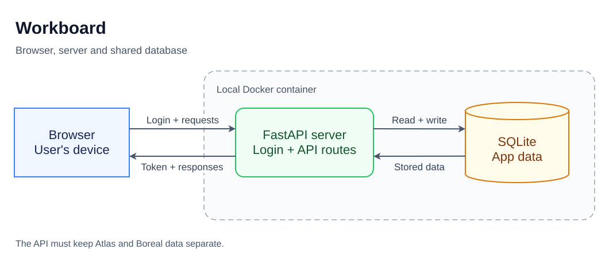

# How Workboard works

Workboard has three main parts:

| Part | What it does | Code |
| --- | --- | --- |
| Browser | Shows the login page, documents and comments | [app/static](../app/static/) |
| FastAPI server | Handles requests, checks accounts and reads or saves data | [app/main.py](../app/main.py) |
| SQLite database | Stores users, documents and comments | [app/db.py](../app/db.py) |

## Data flow

[Editable draw.io file](diagrams/workboard-data-flow.drawio)

The server and database run in one Docker container. The database is a file saved in a Docker volume. Atlas and Boreal share that database.

## Signing in

1. The user sends an email and password.
2. The server checks the password against the stored password hash.
3. If the details are correct, the server returns a JWT: a signed sign-in token that lasts one hour.
4. The browser sends this token with later API requests.
5. The server checks the token and loads the user's organization and role from the database.

The browser keeps the token in JavaScript memory.

## Where security checks belong

The browser is controlled by the user. Hiding a button does not stop someone from sending the API request directly.

The server must check whether the user may perform each action on the requested document. An admin in Atlas must not gain access to Boreal's documents.

Text saved in the database is still user input. The browser must display comment text safely when another user reads it.

The [security rules](security-requirements.md) describe the expected behavior. The [threat model](threat-model.md) shows what has been checked and what remains to test.

## Local address and data

Docker exposes the app at `http://127.0.0.1:8085`. The database is stored at `/data/workboard.db`. See [compose.yaml](../compose.yaml) for these settings.
