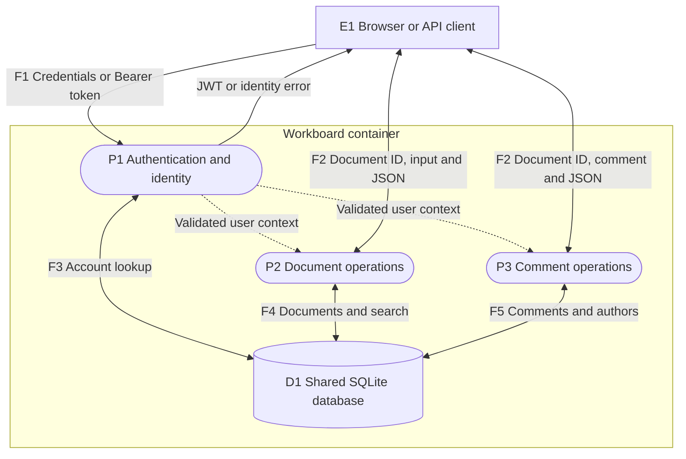
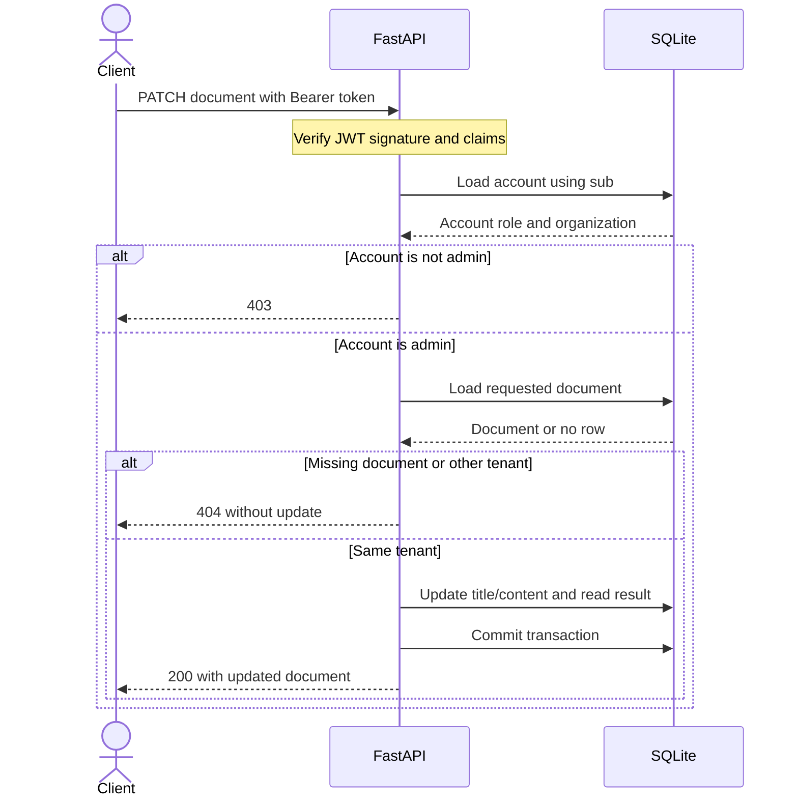

# Architecture

Workboard is a single FastAPI service serving a browser interface and a JSON API. Organizations share one SQLite database. There is no separate database server, worker, export service or external identity provider in this implementation.

## Components and data

| Component | Implementation | Responsibility |
| --- | --- | --- |
| Browser client | [app/static](../app/static/) | Sign-in, document navigation/search, editing and comments; holds the JWT in JavaScript memory |
| API | [app/main.py](../app/main.py) | Authentication, account lookup, document and comment operations |
| SQLite storage | [app/db.py](../app/db.py) | Users, documents and comments; transaction commit/rollback |
| Local runtime | [compose.yaml](../compose.yaml), [Dockerfile](../Dockerfile) | Non-root API container; loopback HTTP port; persistent database volume |

The `users` table stores identity, password hash, organization and role. The `docs` table stores organization, owner, title and content. The `comments` table links a document and author to a comment body. A document's `org_id` determines its tenant; `owner_id` does not grant editing rights independently of role and organization.

## Data-flow diagram

P1–P3 are logical functions in the same Python process. FastAPI resolves `current_user` before protected handlers run; the dotted arrows carry server-loaded `id`, `org_id` and `role`. The diagram shows where controls belong, not a claim that every handler implements them correctly.

| Flow | Data and security decision |
| --- | --- |
| F1 | Credentials are checked against a salted PBKDF2 password hash. Login issues a one-hour HS256 JWT with `sub` and `exp`. Protected requests verify the JWT and load the account from SQLite. |
| F2 | Client-controlled paths, queries and bodies enter document/comment handlers. The API must apply the [authorization policy](security-requirements.md#authorization-policy). API values return to the browser for rendering. |
| F3 | Account role and organization come from stored account data. The client cannot select them through the request body. |
| F4 | Document reads, search and updates access shared tenant data. Scope and SQL construction require review. |
| F5 | Comment creation stores user input; retrieval joins author email. The browser renders the returned body, creating a second input-handling boundary. |

## Trust boundaries

- **Client to API:** requests, IDs and browser state are untrusted. Hiding an edit button is a usability control, not authorization.
- **Tenant separation:** Atlas and Boreal share tables. Organization checks are an application-level boundary, not separate containers or databases.
- **API to storage:** SQLite is a local file accessed with the API's permissions. It provides transactions and constraints, not automatic tenant filtering.
- **Stored input to browser DOM:** database content remains untrusted when rendered as HTML.

In Compose, HTTP is bound to `127.0.0.1:8085` and the database is `/data/workboard.db` in `workboard_data`. The container has a read-only root filesystem, a writable data volume and temporary filesystem, dropped capabilities and process/memory limits. These settings do not establish application authorization.

## API surface

| Area | Routes | Identity |
| --- | --- | --- |
| Workspace and assets | `GET /`, `GET /static/app.js`, `GET /static/style.css` | Public |
| Health and generated API reference | `GET /api/health`, `GET /docs`, `GET /redoc`, `GET /openapi.json` | Public |
| Login | `POST /api/auth/login` | Credentials supplied in body |
| Current account | `GET /api/me` | Bearer JWT |
| Documents | `GET /api/docs`, `GET /api/docs/search`, `GET /api/docs/{doc_id}` | Bearer JWT |
| Document editing | `PATCH /api/docs/{doc_id}` | Bearer JWT; intended admin and same-tenant checks |
| Comments | `GET /api/docs/{doc_id}/comments`, `POST /api/docs/{doc_id}/comments` | Bearer JWT; intended same-tenant checks |

## Protected update flow

This is the current document-update path; other endpoints need their own authorization checks.

Missing or invalid authentication exits with 401 before the handler. See the [test coverage](security-testing.md) for what has actually been verified.
