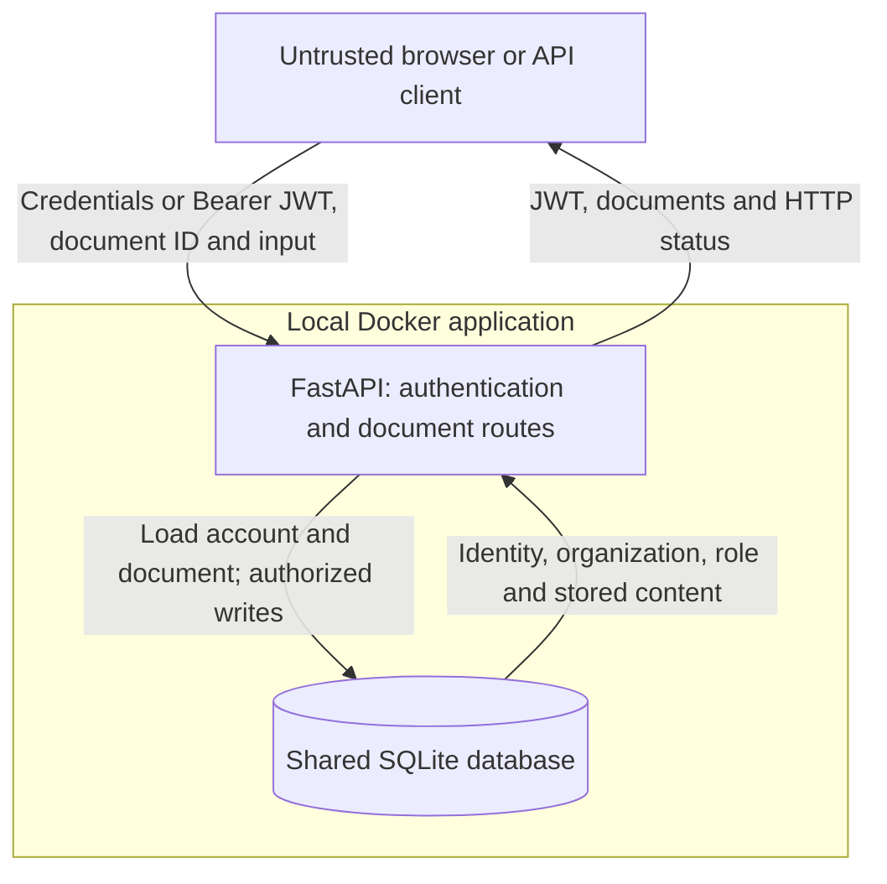

# Security design

Workboard is a local FastAPI/SQLite workspace with two tenants (Atlas and Boreal) and two roles (`admin` and `member`). The assets are private document contents, document integrity, comments and account identity.

## Data flow and trust boundaries

The browser/API boundary is where input and identity must be validated. SQLite is a file accessed by the application, stored in the `workboard_data` volume; it is not a separate network service. Tenant separation is logical: Atlas and Boreal share tables, so the API must enforce ownership on every relevant operation.

Login issues an HS256 JWT containing `sub` and `exp`. On authenticated requests, `current_user` verifies the token and loads the user's role and organization from SQLite. UI controls and client-supplied IDs are not authorization decisions.

## Intended authorization policy

| Action | Own-tenant member | Own-tenant admin | Other-tenant user |
| --- | --- | --- | --- |
| Read a document | Allow | Allow | Deny |
| Read/add comments | Allow | Allow | Deny |
| Edit title/content | Deny | Allow | Deny |

The matrix is the intended policy, not a claim that every route complies. F-01 covers document editing.

## Threat review

| Threat | STRIDE | Control or disposition |
| --- | --- | --- |
| Admin changes a document in another tenant | Tampering | F-01 fixed: check role and document organization before writing |
| Member calls the edit API directly | Elevation of privilege | Admin role check; regression tested |
| User reads another tenant's document by ID | Information disclosure | Open: `read_doc` has no organization check |
| Search input changes SQL structure | Information disclosure / Tampering | Open: `search_docs` interpolates input into SQL; use parameter binding |
| Comment content becomes executable HTML | Tampering / Elevation of privilege | Open: `refreshComments` assigns stored content to `innerHTML`; render text or sanitize permitted HTML |

Open items are observations from source review, not additional completed penetration tests. They remain intentionally outside F-01. This is a focused threat review, not exhaustive STRIDE coverage.

## F-01 requirements and verification

The edit flow is: verify JWT, load account, require admin, load document, compare organizations, then update. A tenant mismatch returns `404 Document not found` before any write.

All test names below are in [the authorization suite](../tests/test_document_authorization.py).

| Requirement | Expected result | Regression test |
| --- | --- | --- |
| Cross-tenant updates are denied in both directions | 404; stored document unchanged | `test_admin_cannot_edit_another_organization` |
| Own-tenant admins can update documents in both organizations | 200; response and stored values match | `test_admin_can_edit_own_organization` |
| Members cannot edit own-tenant or other-tenant documents | 403; stored document unchanged | `test_member_cannot_edit_documents` |
| Missing authentication cannot modify a document | 401; stored document unchanged | `test_unauthenticated_edit_is_denied` |
| Missing documents do not produce a successful update | 404 | `test_admin_editing_missing_document_gets_not_found` |

See the [finding](../findings/F-01-BOLA-document-update.md) and [before/after evidence](../findings/evidence/F-01/README.md). Scanners supplement these tests; generic scanning does not prove tenant isolation.

## Lab assumptions

Testing uses synthetic accounts and a loopback-only Docker service. Demo credentials and the known development JWT secret are not production authentication controls. See [scope and provenance](../SECURITY_SCOPE.md).
